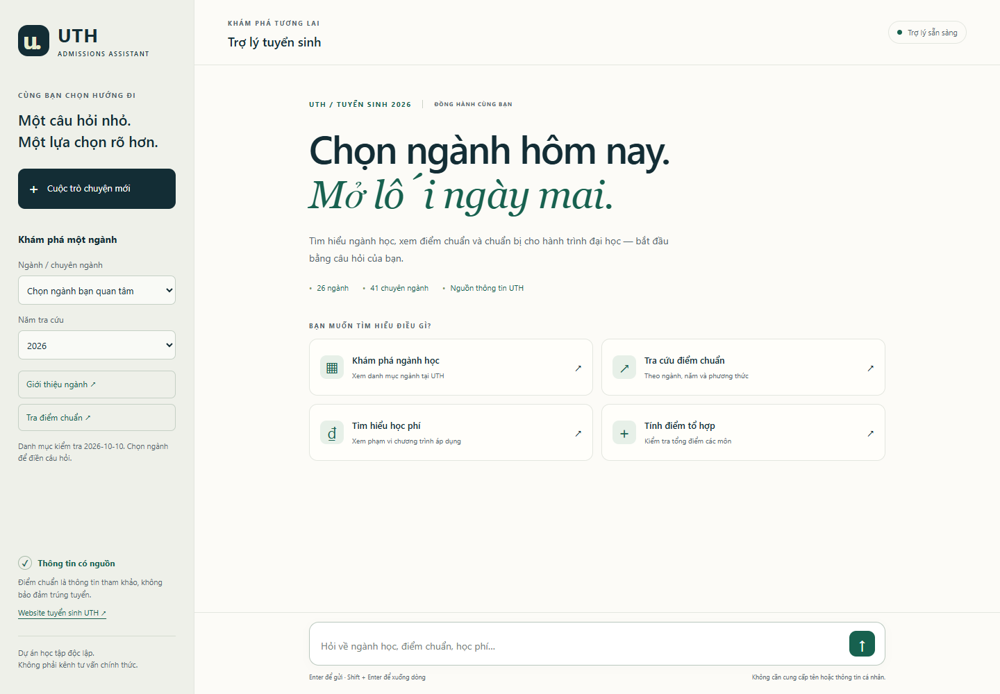

<div align="center">

# UTH Admissions Assistant

**Chọn ngành hôm nay. Mở lối ngày mai.**

Trợ lý tuyển sinh tiếng Việt có ngữ cảnh, dữ liệu có nguồn và giao diện web để trải nghiệm trực tiếp.


[](https://github.com/TrinhQuocDat542005/chatbot-tuyensinh/actions/workflows/ci.yml)

[](https://github.com/TrinhQuocDat542005/chatbot-tuyensinh/releases/tag/v1.0.0)

[Chạy demo](#chạy-demo) · [Tính năng](#tính-năng) · [AI King 2025](#nghiên-cứu--ai-king-2025) · [Đánh giá](#đánh-giá) · [Lộ trình](docs/ROADMAP.md)



[Video demo với model thật · 20 giây](docs/assets/demo.webm) · [Tra điểm chuẩn](docs/assets/demo-cutoff.png) · [Giao diện mobile](docs/assets/demo-mobile.png)

</div>

> Dự án độc lập phục vụ học tập và nghiên cứu, không phải kênh tư vấn chính thức của UTH. Điểm chuẩn chỉ dùng để tham khảo; thông tin chưa xác minh được bot thông báo rõ.

**Bản portfolio v1.0.0:** demo chạy local, không yêu cầu hosting trả phí. Có thể tải model đã kiểm thử và báo cáo từ [GitHub Release](https://github.com/TrinhQuocDat542005/chatbot-tuyensinh/releases/tag/v1.0.0); xem [hướng dẫn bản phát hành](docs/release.md). Triển khai Internet và benchmark public là backlog, chưa được nghiệm thu.

## Tính năng

| Bạn muốn… | Trợ lý hỗ trợ… |
| --- | --- |
| Khám phá ngành | 26 ngành và 41 chuyên ngành, tra giới thiệu và hướng nghề nghiệp khi có nguồn |
| Xem điểm chuẩn | Tra theo ngành, năm, chương trình và phương thức; hiển thị liên kết nguồn |
| Tính điểm tổ hợp | A00, A01, B00, C00, C01, D01, D07; nhận dấu phẩy thập phân và tên môn có/không dấu |
| Hỏi thông tin trường | Học phí theo phạm vi chương trình, địa điểm, phương thức tuyển sinh và nguồn chính thức |
| Hỏi tiếp tự nhiên | Hỏi bổ sung; giữ ngữ cảnh, đổi ngành/năm/phương thức, sửa điểm, hủy và bắt đầu lại |
| Dùng trên web | Responsive, hỏi nhanh, chọn ngành/năm, bảng điểm, nguồn, trạng thái chờ, thử lại và phản hồi hữu ích |

**Dữ liệu hiện có:** 48 bản ghi điểm chuẩn xét tuyển kết hợp năm 2026, có mã chương trình và đợt tuyển sinh. Đây là tập con đã đối chiếu, chưa bao phủ mọi chương trình. Điểm kết hợp không phải tổng ba môn thang 30. Dữ liệu lịch sử 2020–2024 chưa có nguồn/phương thức đáng tin đã được cách ly. Xem [nguồn và phạm vi dữ liệu](docs/data-sources.md).

## Chạy demo

### Docker Linux

Cần Docker Desktop/Engine Linux đang chạy, Git và Python 3.10+ trên máy để chạy script quản lý (script này không cần cài Rasa). Với lần cài đầu:

**Chạy nhanh bằng model phát hành:** checkout tag `v1.0.0`, tải `model-bundle.zip`, giải nén ba file vào `models/`, chạy `python scripts/model_artifact.py verify`, `docker compose build train actions web` rồi `python scripts/manage.py up`. [Hướng dẫn checksum và từng bước](docs/release.md).

**Hoặc train mới từ source:**

```bash
git clone https://github.com/TrinhQuocDat542005/chatbot-tuyensinh.git
cd chatbot-tuyensinh
python scripts/manage.py train
python scripts/manage.py up
```

Mở **[localhost:8686](http://localhost:8686)**. Script build ba image riêng, train mới rồi tạo manifest và SHA-256 trong `models/`. Khi khởi động, model phải khớp checksum và dữ liệu/config của checkout. Train có thể mất vài phút; model không được commit. Xem [hướng dẫn Windows/WSL/Docker và artifact CI](docs/reproducibility.md).

| Thành phần | Địa chỉ local | Vai trò |
| --- | --- | --- |
| Web + gateway | `http://localhost:8686` | Giao diện và API cùng origin |
| Rasa | `http://localhost:5005` | NLU và quản lý hội thoại |
| Action server | `http://localhost:5055` | Tra dữ liệu, tính điểm và kiểm tra slot |

Các cổng Compose chỉ bind trên `127.0.0.1`. Dừng demo bằng `python scripts/manage.py down`.

### Đã có backend đang chạy

Web/gateway chỉ cần thư viện chuẩn Python; không cần Node hay `npm install`:

```bash
python scripts/serve_web.py
```

Đổi endpoint/cổng nếu cần:

```bash
python scripts/serve_web.py --port 8686 --rasa-url http://127.0.0.1:5005
```

### Năm tác vụ để trải nghiệm

1. Bấm **Khám phá ngành học**, rồi gửi câu hỏi đã điền.
2. Chọn **Công nghệ thông tin** → **Giới thiệu ngành**.
3. Chọn năm **2026** → **Tra điểm chuẩn**; hỏi tiếp “còn năm 2023?” để đổi ngữ cảnh.
4. Bấm **Tính điểm tổ hợp**, gửi điểm ba môn và xem bảng tổng điểm.
5. Bấm **Tìm hiểu học phí**; xem chương trình áp dụng và nguồn trước khi tham khảo con số.

Enter để gửi, Shift + Enter để xuống dòng. **Cuộc trò chuyện mới** tạo ID mới và xóa lịch sử đang hiển thị; tải lại trang cũng bắt đầu phiên mới. Mỗi trang/tab có phiên riêng. Lỗi kết nối không xóa lịch sử hiện tại; nút **Thử gửi lại** giữ câu hỏi đã nhập.

<details>
<summary><strong>Cài backend trực tiếp bằng Python 3.10</strong></summary>

Rasa 3.6 yêu cầu Python 3.10; không dùng Python 3.11+ cho cấu hình này.

```bash
python3.10 -m venv .venv
source .venv/bin/activate
python -m pip install -r requirements-dev.txt
python -m pip check
python -m rasa train --data data --fixed-model-name admissions-week4
```

Windows: tạo venv bằng `py -3.10 -m venv .venv`, kích hoạt bằng `.venv\Scripts\Activate.ps1`. Mở hai terminal:

```bash
python -m rasa_sdk --actions actions --port 5055
python -m rasa run --model models/admissions-week4.tar.gz --endpoints endpoints.yml --port 5005
```

Hoặc dùng `scripts/run-local.ps1 -Mode actions` / `-Mode server`. Nếu Windows Application Control chặn DLL scikit-learn, dùng Docker Linux.

`requirements-lock.windows.txt` là snapshot môi trường Windows của lần triển khai, không phải lock Linux. Các model tháng 05/2025 trong lịch sử Git không đáp ứng domain/actions mới; dùng bundle phát hành hoặc train mới.

</details>

## Nghiên cứu · AI King 2025

Dự án gắn với quá trình tham gia **cuộc thi AI King tại Trường Đại học Hùng Vương TP.HCM**, theo chia sẻ của chủ repository. Bài nghiên cứu liên quan được lưu trong kỷ yếu **AI King: Shaping the Future**, ngày **30/07/2025**:

> **Xây dựng chatbot tư vấn tuyển sinh cho trường đại học**<br>
> Nguyễn Thanh Tiến · Phan Phát Đạt · Trịnh Phát Đạt · Nguyễn Quyền<br>
> Nhà xuất bản Thông tin và Truyền thông · trang 372–382

**[Đọc tài liệu PDF](docs/research/aiking2025-proceedings.pdf)** · [Thông tin thư mục và trích dẫn](docs/research/README.md)

File gồm trang bìa và bài báo, 12 trang PDF. Số liệu trong bài thuộc phiên bản nghiên cứu năm 2025; chất lượng mã nguồn hiện tại được đo riêng trong phần dưới.

## Đánh giá

NLU đo ngày **10/10/2026** trên 154 câu tự soạn cố định, gồm 54 câu khó/ngoài phạm vi. Dev có 44 câu riêng. Không có câu trùng nguyên văn giữa train/dev/test; tập test đã được review lỗi nên lần đo cuối là kiểm tra hồi quy, chưa xác nhận chất lượng trên câu người dùng thực.

| Chỉ số | Tuần 1–2 | Tuần 4 lần đầu | Sau mở rộng train |
| --- | ---: | ---: | ---: |
| Macro-F1 intent | 0,4333 | 0,7251 | **0,9247** |
| F1 entity exact span | 0,6465 | 0,9700 | **0,9490** |

Baseline chưa có ba intent mới, nên mức tăng phản ánh cả mở rộng phạm vi. Entity giảm nhẹ so với lần đầu; nhận diện ngoài phạm vi vẫn cần cải thiện.

Fresh train tuần 6 giữ nguyên dữ liệu/config: local đạt macro-F1 intent **0,9394**, entity exact-span F1 **0,9505**; runner GitHub sạch đạt **0,9117/0,9596**, đều vượt gate hồi quy. Fresh training có thể cho trọng số/chỉ số khác nhau; xem [báo cáo tuần 6 và provenance](docs/evaluation/week6-summary.json).

**Hội thoại backend tuần 4:** 10/10 Core, 22/22 kịch bản REST nhiều lượt và 4/4 luồng nhiều lượt bằng câu tự nhiên pass. Bộ Python portfolio hiện có 141 test: 117 backend, 14 HTTP gateway, 7 kiểm tra tái lập/CI và 3 kiểm tra audit. Clone sạch dùng model phát hành đã pass toàn bộ, cùng 13 nhóm UI thật. Xem [nghiệm thu portfolio](docs/week8-status.md).

[Báo cáo tuần 4](docs/week4-status.md) · [Chỉ số, hash và câu sai](docs/evaluation/week4-summary.json)

```bash
docker compose run --rm check
docker compose exec actions python scripts/smoke_actions.py
docker compose exec rasa python scripts/smoke_rest.py
docker compose exec rasa python scripts/check_conversations.py
docker compose exec rasa python scripts/check_conversations.py --cases tests/conversations/natural.json --out results/conversations/natural-report.json
```

**CI:** mỗi PR chạy correctness lint Python, actionlint, kiểm tra YAML/JSON/schema, 141 test, scanner secret và UI với backend mô phỏng. Thay đổi dữ liệu/cấu hình/nghiệp vụ kích hoạt workflow model: build sạch, train, Core/NLU, hội thoại REST và UI với model thật. Luồng này cũng chạy hàng tuần hoặc manual. Model, manifest/checksum và báo cáo được xuất thành artifact theo commit; xem [quy trình tái lập](docs/reproducibility.md).

<details>
<summary><strong>Kiểm thử giao diện và quay demo (Node.js 20+)</strong></summary>

Khi demo local đang chạy:

```bash
npm ci
npx playwright install chromium ffmpeg
npm run test:web
node tests/web/record.cjs
```

13 nhóm kiểm tra bao gồm năm tác vụ với model thật, desktop/mobile, retry, tách phiên và hiển thị an toàn. `CHROME_EXECUTABLE` cho phép dùng Chrome có sẵn; `WEB_URL` đổi địa chỉ demo. Chế độ `npm run test:web -- --mock` chỉ kiểm tra hành vi giao diện với backend mô phỏng. Xem [báo cáo UI](docs/evaluation/week5-ui.json).

</details>

## Kiến trúc

```text
Trình duyệt :8686
   │ POST /api/chat (cùng origin)
   ▼
Python gateway ──► Rasa :5005 ──► Action server :5055
                     │                  │
                NLU + Core       JSON có schema,
                forms + slots    nguồn và phạm vi
```

Frontend HTML/CSS/JavaScript thuần, không có dependency runtime bên ngoài. Gateway dùng thư viện chuẩn Python, giới hạn payload, phục vụ file theo danh sách cho phép và proxy đến Rasa. Trả lời được dựng bằng DOM text; chỉ hỗ trợ Markdown giới hạn và link HTTP(S), không chạy HTML từ tin nhắn.

| Thư mục | Nội dung |
| --- | --- |
| `web/` | Giao diện responsive và Dockerfile web |
| `actions/` | Nghiệp vụ, parser, repository, schema và dữ liệu |
| `data/` | NLU, rules, stories, lookup và regex |
| `components/` | Bộ lọc entity trong pipeline Rasa |
| `scripts/` | Gateway, validation, smoke, đánh giá và calibration |
| `tests/` | Unit test, HTTP test, hội thoại và tập đánh giá |
| `docs/` | Roadmap, báo cáo, ảnh demo và tài liệu AI King |

## Dữ liệu và quyền riêng tư

- Không bắt buộc tên; nên tránh gửi thông tin cá nhân nhạy cảm vào demo.
- ID phiên ngẫu nhiên chỉ nằm trong bộ nhớ trang, không đưa tên/điểm vào URL. Web không lưu lịch sử trong `localStorage` hoặc `sessionStorage`.
- Rasa có thể giữ tracker/ngữ cảnh trong tiến trình. Tạo phiên mới không phải yêu cầu xóa tracker cũ trên server.
- Phản hồi hữu ích chỉ ghi ID câu trả lời ngẫu nhiên và phiếu đánh giá vào `results/web-feedback.jsonl`, không ghi nội dung hội thoại, tên hay điểm. `results/` bị ignore.
- Gateway cache phản hồi thành công tối đa 10 phút. Timeout vẫn có thể xảy ra sau khi Rasa đã xử lý; đây không phải bảo đảm xử lý đúng một lần.

Demo hiện phục vụ local. Xác thực, rate limiting, lưu trữ tracker và vận hành công khai thuộc giai đoạn triển khai tiếp theo.

## Lộ trình và đóng góp

[Lộ trình](docs/ROADMAP.md) · [Tuần 1–2](docs/week1-2-status.md) · [Tuần 4](docs/week4-status.md) · [Tuần 5](docs/week5-status.md) · [Tuần 6](docs/week6-status.md) · [Phát hành portfolio](docs/release.md)

Khi bổ sung dữ liệu, ghi nguồn chính thức, ngày kiểm tra, năm/phương thức và thang điểm. Giữ tập đánh giá ngoài `data/`, thêm kiểm tra lỗi nghiệp vụ và ghi kết quả thực đo. Issue nên có bước tái hiện, câu hỏi và kỳ vọng; bỏ thông tin cá nhân trước khi gửi.

[Đóng góp](CONTRIBUTING.md) · [Bảo mật](SECURITY.md) · [Changelog](CHANGELOG.md) · [Quyền sử dụng](LICENSE) · [Nguồn và quyền bên thứ ba](NOTICE.md).

Mã nguồn hiện giữ quyền tác giả, chưa cấp giấy phép mã nguồn mở khi quyền của các đồng tác giả chưa được xác nhận. Tài liệu AI King, dữ liệu dẫn nguồn và dependency giữ quyền/giấy phép riêng.
